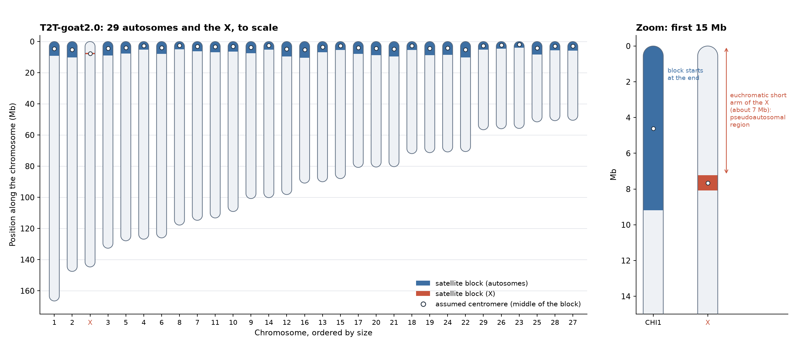
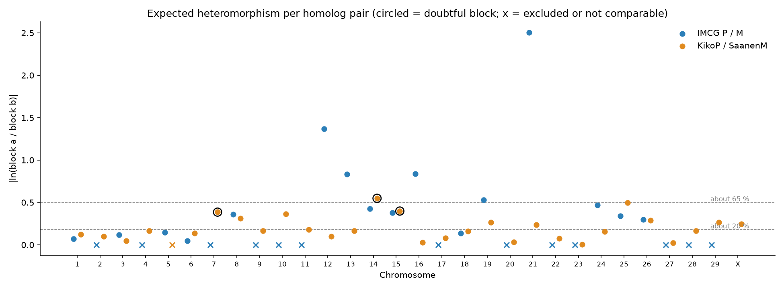
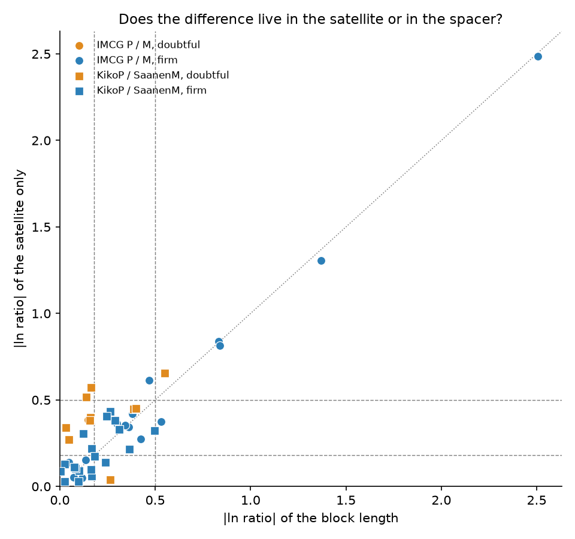
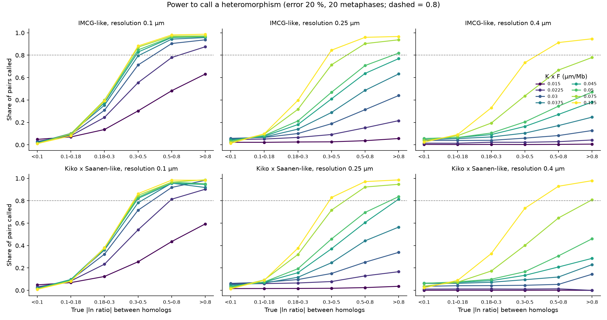
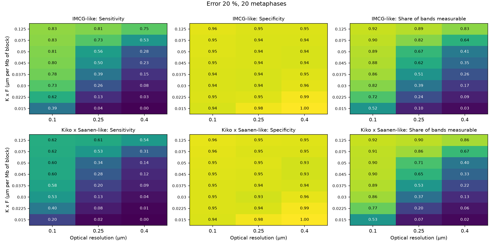

# Karyotype inference and simulated C-banding/FISH for *Capra hircus*
### What would a microscope see of the centromere differences I found in the goat genome?

> This is a personal portfolio and practice project, not a peer-reviewed article. Every cytogenetic measurement in it is simulated. I built it with the help of an AI coding assistant (Claude Code), and I reviewed the decisions and the results.

In my companion repository, [capra-hircus-centromeres](https://github.com/tiagoherrador/capra-hircus-centromeres) (private), I measured the satellite DNA blocks at goat centromeres using public genome assemblies. One thing stood out: the two copies of a chromosome often differ a lot in that block. Here I take those tables as they are and ask a simple question: if those differences were real, could a microscope see them? I don't repeat any of the sequence work here (downloads, satellite annotation, scaling statistics). It all lives in the other repository.

## The question

> If the differences between the two copies of a chromosome that I see in the sequence were real, could a cytogenetic design (C-banding or FISH) detect them? With how many cells, and with what measurement quality?

This is a question about experimental design, so I answer it by simulation, in three steps that follow the notebook. First I ask what the sequence predicts: what the karyotype looks like and which chromosome pairs should differ between their two copies (a difference called heteromorphism). Second, I ask how far I can trust that prediction, given assembly artefacts and doubtful blocks. Third, I ask which design, in number of cells, measurement error and microscope resolution, would be able to detect the differences.

Along the way I wanted to end up with an inferred karyotype and an idiogram with clear inclusion rules, and with the expected differences for each pair, reporting the two animals separately: the reference animal, whose haplotypes I call P and M, and a Kiko × Saanen female, whose haplotypes come from two breeds. I also wanted a simulator of C-banding and FISH measurements built on the corrected tables of the four haplotypes, a sensitivity analysis that shows how the results move when the weakest assumptions change (instead of one single answer), and a public list of those assumptions in [docs/ASSUMPTIONS.md](docs/ASSUMPTIONS.md).

## What this project does not do

I can't tell you which C-band a real goat would show, because there are no public cytogenetic measurements of this animal. I also don't measure the functional centromere (CENP-A): my "centromere" is the satellite block from the sequence repository, which is an operational definition. The functional domain may be much steadier between haplotypes than the satellite array, so a big difference in the array doesn't mean a big difference in the functional centromere.

I don't settle whether the goat chromosomes are acrocentric or telocentric either. The literature calls them acrocentric, meaning they have a very short arm. What the sequence shows is that the satellite block starts less than 0.05 Mb from the end of every autosome, so there is no short arm of ordinary DNA that I can resolve. I don't measure where the centromere sits inside the block, so the centromeric index, the arm ratio and the Levan class are all given as "if the centromere is at the middle of the block", which is an assumption. The X is the one case with a real short arm.

Finally, sensitivity, specificity and power describe the simulated design under the assumptions I state. They are not statements about the real world.

## The main caution

I take the optical limit of a light microscope to be about 0.25 µm. That is a rough figure from Abbe's formula (0.61 λ / NA, with λ = 550 nm and NA = 1.4), calculated by the AI assistant. I haven't checked it against real C-banding practice, so I treat it as a parameter. Under some of my assumptions the typical difference between two copies of a chromosome is close to that limit or below it. That is why I vary the optical resolution explicitly, together with the chromosome scale (K, µm of chromosome per Mb) and the band-to-block factor (F, how many times the block the band looks). I found no goat-specific value for K or F ([assumptions](docs/ASSUMPTIONS.md)).

## Inputs

I keep frozen copies of six small tables from the sequence repository in `data/input_from_repo1/`, together with the commit they come from and their SHA-256 checksums in `SOURCE.md`. The notebook verifies them before reading. I don't use the blocks flagged `low_satellite` (M-CHI7, M-CHI9, M-CHI29) as ground truth, and I leave out Saanen CHI5.

## What I found

All three stages are done and executed. What is still missing is a check of K, F and the optical limit against real goat cytogenetic measurements, which would need data I don't have.

### Stage 1: what the sequence predicts



*Idiogram of the 30 chromosomes of T2T-goat2.0 (ordered by size, X in red). The shaded part is the satellite block, my operational centromere. The white dot is the assumed centromere, which I place at the middle of the block because the sequence doesn't locate it. The right panel zooms in on the first 15 Mb of CHI1 and of the X: the block of an autosome starts right at the chromosome end, while the X has a short arm of ordinary DNA of about 7 Mb. It is a map of where heterochromatin could be, not a prediction of a real band.*

In all 29 autosomes of every haplotype the satellite block starts less than 0.05 Mb from the end of the chromosome. If I put the centromere in the middle of the block, the arm ratio is above 10 and the Levan class is "terminal", which fits both acrocentric and telocentric; where the centromere really sits inside the block, I don't know. The X is the only chromosome with a real short arm: about 7 Mb of euchromatin (the pseudoautosomal region) before its block, which starts 7.2 Mb from the end.

For the differences between the two copies of each chromosome, I use the median |ln ratio| of the block. It is 0.37 in the reference animal's P/M pair (16 usable chromosomes) and 0.17 in the KikoP/SaanenM pair (29 usable chromosomes, which I label "between breeds"). In the rest of the chromosome the same measure is only about 0.001–0.002. The reference animal has few usable pairs because 13 of its 29 are incomplete or `low_satellite` in at least one haplotype. The tables are in `data/outputs/karyotype_inferred.csv` and `expected_heteromorphisms.csv`.



*Expected heteromorphism per chromosome, as |ln(block a / block b)|, for the two pairs of haplotypes. Circled points are doubtful blocks; crosses are excluded or not comparable pairs.*

### Stage 2: how far I trust it

I label each usable pair **firm** or **doubtful**. A pair is doubtful if it includes a doubtful block, if the block length and the satellite-only length disagree by more than 0.2 in |ln ratio|, or if the larger haplotype flips when I count only satellite (tables in `data/outputs/robustness_pairs.csv` and `robustness_scenarios.csv`).

In the reference animal, 15 pairs are firm and 1 is doubtful. The difference lives in the satellite and not in the spacer: the two measures correlate at 0.88 (Spearman), the larger haplotype never changes, and the median |ln ratio| is 0.37 both with the whole block and with the satellite only. The Kiko × Saanen female is less clear: 19 pairs are firm and 10 doubtful. The two measures agree much less (Spearman 0.49), and with the satellite only the median difference is larger (0.27 against 0.17), which suggests that the non-satellite spacer partly hides differences. Removing her three doubtful blocks hardly moves the block-length median (0.16).

For the simulation, this means I estimate the spread of the true difference from the 34 firm pairs, and the doubtful ones only enter a sensitivity run. I don't use a pair's size class as a truth label, because pairs near a class boundary change class too easily.



*Does a difference live in the satellite or in the spacer? Points on the diagonal give the same answer with both measures; blue pairs are firm, orange ones doubtful.*

### Stage 3: what a microscope could detect

Everything in this section is simulated. I ran the simulator on 324 scenarios with 300 replicates each, varying K, F, optical resolution, measurement error, number of metaphases and the two heteromorphism spreads. The tables are in `data/outputs/sim_*.csv`.

What decides the outcome is the resolution of the microscope and the size of the band, while the measurement error and the number of cells hardly matter. The median sensitivity goes from 0.44 to 0.46 between 10 and 20 metaphases, and from 0.46 to 0.42 between 10 % and 30 % error. In contrast, for differences like the reference animal's it goes from 0.77 to 0.48 to 0.22 as the resolution goes from 0.1 to 0.25 to 0.4 µm.

Sensitivity also has a ceiling that comes from my own calling rule. I count a pair as truly heteromorphic above |ln ratio| 0.18, but I only call it above 0.25, so even a perfect measurement misses the true differences in between. That ceiling is 0.88 for differences like the reference animal's and 0.67 for differences like the Kiko × Saanen female's. I derived it analytically, and the simulator reproduces it with a perfect measurement (0.879 and 0.673), so sensitivity should be read against that ceiling and not against 1.

With differences like the reference animal's (sigma 0.40), the best scenario reaches a sensitivity of 0.85, which is 0.97 of the ceiling. Sensitivity of at least 0.8 with specificity of at least 0.9 happens in 20 of 162 scenarios, nearly all at 0.1 µm resolution with 10–20 % error. At 0.25 µm only the largest bands manage it (K × F = 0.125), and at 0.4 µm none does. With differences like the Kiko × Saanen female's (sigma 0.17) a sensitivity of 0.8 is out of reach by design, because the ceiling is 0.67. The best scenario reaches 0.64 (0.96 of the ceiling), and 40 of 162 scenarios reach at least 0.8 of the ceiling with specificity of at least 0.9. In other words, the criterion would call two thirds of the true differences at best, and only with a fine resolution and large bands.

Specificity stays between 0.83 and 1.00. With no true heteromorphism at all it is 0.999 at 10 % error and 20 metaphases, and 0.895 at 30 % error and 10 metaphases. The biggest loss comes from bands that can't be measured. In my middle scenario (K 0.03, F 1.5, 0.25 µm, 20 % error, 20 metaphases) only 62–65 % of the bands are measurable, with a sensitivity of 0.50 for the reference-animal-like differences and 0.28 for the Kiko × Saanen-like ones, and a specificity of 0.94–0.95.

When I compare the measurement with the sequence across the 30 chromosomes (Spearman), the C-band reaches a median of 0.29 against a ceiling of 0.32. FISH does better, with 0.56 for SatI, 0.43 for SatII and 0.63 for SatIII, although that depends on the probe gains I assumed. The ceiling is low because the block lengths of T2T correlate only 0.33 with the four-haplotype consensus: the order of the blocks by size isn't well conserved between animals. I don't interpret the slope of the C-band against the remaining chromosome length, because its bias ranges from −0.20 to +0.27 depending on the scenario. Finally, the ground truth matters little: removing the doubtful blocks and taking the spread from all usable pairs moves sensitivity by at most 0.02 and specificity by less than 0.01 in the middle scenario (`sim_sensitivity_truth.csv`).



*Simulated: share of chromosome pairs called heteromorphic, by the size of the true difference, for each band size per Mb (K × F) and optical resolution.*



*Simulated: sensitivity, specificity and share of measurable bands over band size and optical resolution (error 20 %, 20 metaphases). Sensitivity must be read against its ceiling of 0.88 (reference-animal-like) and 0.67 (Kiko × Saanen-like).*

## Repository structure

```
├── notebooks/01_karyotype_and_simulation.ipynb   the three stages
├── data/input_from_repo1/                        frozen inputs + SOURCE.md
├── data/outputs/                                 tables written by the notebook
├── figures/
├── docs/ASSUMPTIONS.md                           every assumption of the simulation
├── LICENSE · LICENSE-CC-BY-4.0.txt · CITATION.cff · requirements.txt
```

## Reproducibility

```bash
python3 -m venv .venv && source .venv/bin/activate
pip install -r requirements.txt
jupyter lab notebooks/01_karyotype_and_simulation.ipynb
```

You don't need any downloads or external tools. The full run takes about 2.5 minutes on my Apple-silicon laptop (324 scenarios × 300 replicates). For a quick test, set `CAPRA_NREP=20` before starting Jupyter.

## Licence

The code is under MIT ([LICENSE](LICENSE)); the text and figures are under CC BY 4.0 ([LICENSE-CC-BY-4.0.txt](LICENSE-CC-BY-4.0.txt)).
